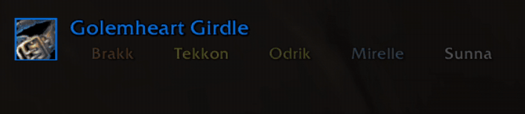

# Loot Rolls Forever

When your group rolls for a blue or better item, you see every player's choice, the rolls and the winner as plain floating text. No window, no frame.

## Features

- **Choices:** each party member's name lights up with the dice, coin or pass icon when they choose.
- **Result:** the winner and the winning roll in gold, the other rolls small underneath.
- **Floating text:** no background and no border. It fades in, stays a few seconds after the winner is known and fades out.
- **Several items:** rolls on more than one item stack below each other.
- **Raids:** with more than five players it shows a count per choice, and the rolls drop in as a list under the winner.
- **Dismiss:** hover the item icon and click the checkmark to clear an item early.
- **Hover:** the item shows its tooltip, the choices show who picked what, a raid result shows every roll.
- **Place and size:** a looping preview you can drag, with a size slider on right-click.
- **Light:** one small file, no libraries, nothing running while nothing is being rolled.

## Install

Copy the `LootRollsForever` folder into `World of Warcraft\_forever_\Interface\AddOns\`.

## How to use

It shows up by itself when a roll starts. Type `/rolls test` to play an example, `/rolls test raid` for a raid one. Type `/rolls move` to place it: drag the preview, right-click it for the size, then click Done.

## Licence

MIT, see [LICENSE](LICENSE).
